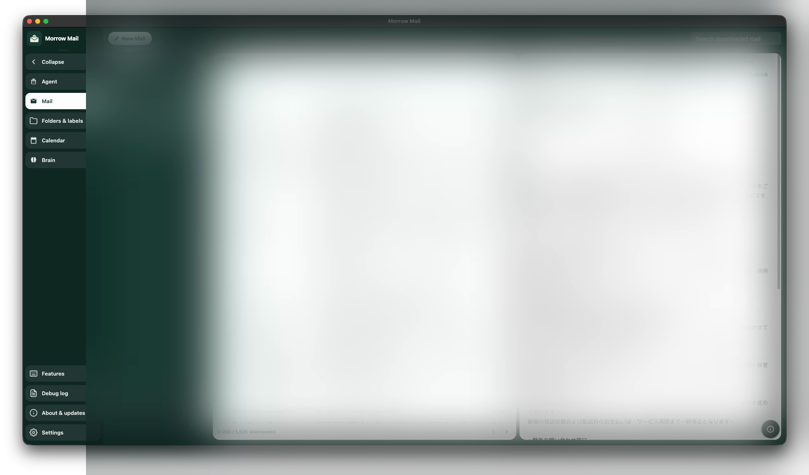
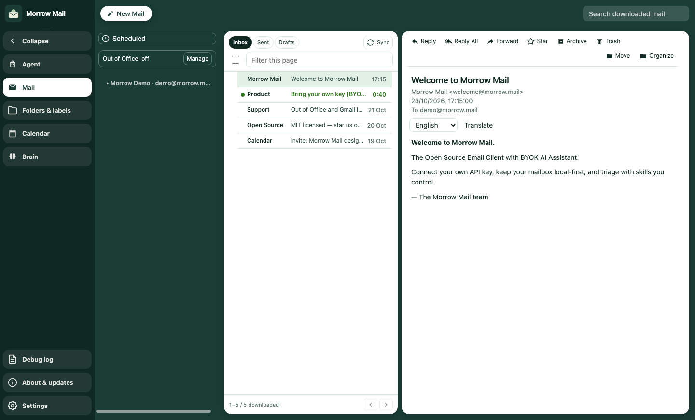
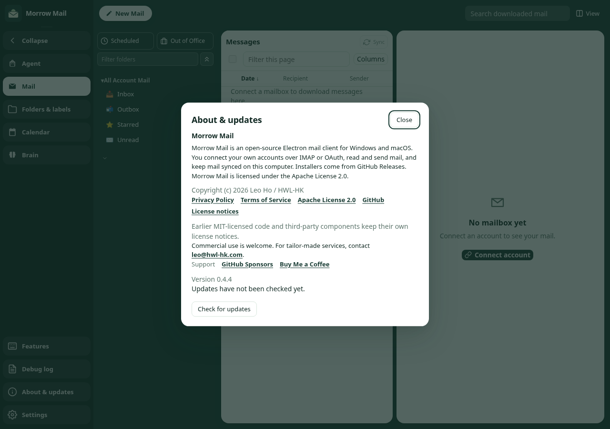

# Morrow Mail

[](LICENSE)
[](https://hwl-hk.com/en/morrow-mail)
[](https://github.com/sponsors/Coke1120)
[](https://buymeacoffee.com/coke1120)

Website: [https://hwl-hk.com/en/morrow-mail](https://hwl-hk.com/en/morrow-mail)

Support: [GitHub Sponsors](https://github.com/sponsors/Coke1120) · [Buy Me a Coffee](https://buymeacoffee.com/coke1120)

Morrow Mail is an open-source Electron mail client for Windows and macOS. Connect your own mailboxes, read and send mail, and optionally use AI to prepare replies, organize your inbox, or brief you on recent mail.

Download the desktop app from [GitHub Releases](https://github.com/Coke1120/Morrow-Mail/releases). Ordinary mail works without AI or Bot access.

## Features

The features below are implemented in **[v0.3.21](https://github.com/Coke1120/Morrow-Mail/releases/tag/v0.3.21)**; see its [release notes and validation limits](docs/releases/v0.3.21.md). Development happens on `dev`, so later branch changes and design proposals should not be assumed available in an installed release. The app's **Features** page includes the capability catalog, **Shortcuts**, and **CLI** tabs.

### Mail, accounts, and calendar

| Feature | What it does |
| --- | --- |
| Multiple mailboxes | Connect Google, Microsoft, Yahoo, or other IMAP/SMTP accounts. New Google OAuth connections use Gmail API; Microsoft mail uses Outlook IMAP/SMTP. Yahoo uses an app password. Other providers offer server discovery and manual settings. |
| Combined mail views | All Account Mail brings downloaded mail together, with Inbox, Outbox, Starred, and Unread views. Its Inbox uses Gmail All Mail when available and Inbox for other accounts. Per-account folders and unread counts remain available. |
| Reading and organization | Conversation view, separate reader windows, star/read controls, Archive, Trash, Snooze, folder moves, and Gmail labels. Bulk Archive/Trash and eligible Undo actions show confirmation and outcome details. |
| Search and list layout | Toolbar search uses a local full-text index of synced subject, sender, and body, with up to 100 results. The page filter only matches loaded subject, sender, and snippet text. Sort downloaded mail by Date, Recipient, Sender, or Subject; reorder columns with drag or keyboard controls. |
| Compose and identities | New mail, Reply, Reply All, Forward, and saved drafts open in a separate compose window. Choose authorized From identities across connected mailboxes, local display names, account/domain signatures, and optional domain CC/BCC defaults. Recipient suggestions come from synced mail, not a contacts directory. |
| Attachments | Preview supported images/PDFs, Open, Save, or Save as ZIP. Transfers show progress and cancellation controls. Downloads are on demand, with limited reuse of completed files while the app is open. Desktop attachment access is broader than Bot access. |
| Undo Send and Send later | Send can wait in the local Outbox for an undo delay, normally 30 seconds. Undo reopens a recovery draft before delivery starts. Send later stores mail on this computer and delivers while Morrow is open; quitting with pending sends asks first. Uncertain or partial deliveries require review. |
| Inbox rules and Out of Office | Manage Gmail filters and Outlook inbox rules with provider permission; other mailboxes use local rules on newly downloaded Inbox mail. Confirmed Out of Office changes use Gmail vacation settings, Microsoft automatic replies, or supported IMAP ManageSieve. Morrow does not generate local automatic replies. |
| Calendar | Google Calendar and Microsoft Graph month/agenda views, multiple checked calendars, and event create/edit/delete. Calendar needs provider access; it is optional and other calendar providers are unavailable. |
| New-mail notifications | Windows/macOS notifications for recent unread Inbox arrivals while Morrow is running, awake, and syncing. Sender/content are hidden by default; Settings → Mail & Sync controls previews and alerts. OS permissions and Focus/Do Not Disturb govern delivery. |
| Setup and sync status | A resumable first-use guide covers mailbox, calendar, sender names, signatures, and optional AI. Sync shows per-mailbox list/body activity and retry status. Off-hours body fill runs from 00:00–07:00 local time while the app is open and awake; attachment files remain on demand. |
| Updates and help | About & updates checks for releases and offers supported download/install flows. Features documents capabilities and shortcuts; Debug log offers a support-copy preview. Review diagnostic content before sharing it. |

Use **Continue with Google** for the default browser sign-in, using the bundled client when present. A personal Google Desktop client is optional under Settings → Accounts → Advanced; see the [personal-client guide](docs/bring-your-own-google-oauth.md). Existing Google OAuth IMAP accounts require a reviewed Gmail API migration. Google Calendar has a separate grant; Microsoft uses a separate Graph bundle for calendar, organize, Out of Office, and rules. Provider publishing, verification, and organization consent requirements still apply. See [OAuth setup and limitations](docs/OAUTH.md).

### Agent page and Email Brain

The **Agent** rail button opens a full page with Todos, Conversation, and Skills. It uses downloaded mail and the configured AI connection:

- **Triage and todos:** group recent inbox mail into editable Brain categories, including Needs You, FYI, and Other. Todos have List and Card views, summaries, message peeks, Reply, Done, and Dismiss. Done/Dismiss are local todo actions. A successful Reply/Reply All completes its linked Needs You todo; marking mail read completes it only with the separate Settings opt-in, or **Mark read & done**.
- **Conversation:** ask about cached mail, request triage or a draft reply, and revisit saved run history. Conversation and standing notes persist on this computer. AI replies open for review; you choose Send.
- **Built-in and custom skills:** Morning Brief, Catch Me Up, Organize Inbox, Plan My Week, Newsletter Digest, Brief This Person, and Meeting Prep. Install/remove catalog skills or write custom instructions, with optional person/calendar context and filing proposals. Organize proposals wait for Confirm before moving mail.
- **Skill schedules:** run on demand, at an interval, or on a five-field cron schedule; pause, resume, or remove a schedule. Scheduled AI work needs background permission and Morrow running. A missed schedule coalesces into one run after reopening.
- **Email Brain:** review and refresh a mail-derived profile, identity, writing rules, categories, and skills. Settings → Learned lists repeated local category moves, read/reply patterns, and suggestion interactions. Learned patterns can be deleted; they do not independently send mail, move it, or rewrite mailbox rules.

AI requires a ready connection and explicit data permission. See [Brain skills and Agent behavior](docs/BRAIN_AGENT.md) and [AI data use](docs/AI_DATA_USE.md).

### Bot access

**Settings → Bot access** connects **Grok Bot** or **Hermes Agent** to a scoped API. Access starts **off**. The listener binds to `127.0.0.1:47831`; another device needs separately configured private Tailscale Serve, an installation ID, and the bot's bearer credential. Saving a hostname does not install or configure Tailscale. Funnel access is unsupported.

Choose mailboxes and permissions per bot. Expiry, credential rotation, revoke/delete, connection checks, setup prompts, and Activity receipts are available.

| Capability | Current behavior |
| --- | --- |
| Cached reads | List granted accounts, list/search downloaded mail, read permitted cached text, and inspect health. Reads do not fetch missing bodies or mark messages read. Attachment permission exposes cached metadata, not file bytes. |
| Proposals | Read structural Agent proposals and submit/list inert draft proposals. Open a proposal in compose to review and send it yourself; submitting a proposal does not save a provider draft or send mail. |
| Send mail | A separate, default-off `mail.send` grant allows immediate plain-text sends from the reviewed mailboxes and authorized identities. These sends do not wait for a desktop Send click. Rate limits and durable request receipts apply. |
| Mail changes | Separate, default-off Archive, read/unread, and Trash grants authorize `mail.archive`, `mail.mark_read`, and `mail.trash` for one identified cached message per request. Trash never permanently deletes mail. |
| Proactive notify | Separately opt in to scheduled cached-mail digests to a private loopback/Tailscale webhook while Morrow is open and awake. Choose Bearer webhook or native Hermes HMAC V2. Headers/snippets are the default; cached text needs body permission. Push does not run Morrow AI or send mail; the receiving bot decides what to do. |

Send and mail-change commands require a UUID request ID. Repeating the same ID and content observes the original receipt without submitting again. A queued mail change is not provider confirmation; unknown or partial outcomes require review. Revoke/disable blocks unsubmitted work but cannot recall a provider submission or webhook data already delivered. Webhook HTTP acknowledgement does not establish agent completion or guarantee complete/exactly-once mailbox coverage.

See the [Bot bridge guide](docs/BOT_BRIDGE.md) for setup, permissions, limits, receipts, Tailscale, and native Hermes routing. The [v1 contract](shared/bot-contract-v1.json) lists supported operations.

### CLI and API

The current CLI is the Node helper **`scripts/morrow-bot-call.js`**, also available as **`npm run bot:call -- …`** from a source checkout. Features → CLI lists checkout commands, API capabilities, JSON examples, and Tailscale steps. There is no standalone installed `morrow` command.

With Morrow running and Bot access explicitly enabled, create `params.json` containing `{}` and use the installation ID from Settings:

```bash
npm run bot:call -- \
  --token-file /path/to/private/morrow-bot-token \
  --installation '<installation-id-from-settings>' \
  --operation bridge.describe \
  --params-file ./params.json
```

The token path and installation ID above are placeholders. Keep the one-time bot secret in a private credential file, restricted to your user (for example, mode `0600` on macOS). Use `--token-file`; never put the secret in a command argument, chat, or git. For another device, add the exact paired HTTPS `--endpoint` after completing the [Serve setup](docs/BOT_BRIDGE.md#tailscale-serve).

The helper calls `POST /api/bot/v1/call`. Supported operations include cached reads, health, proposals, `mail.send`, and the three mail-change commands above. It does not retry automatically. Full CLI examples and required params are in the [Bot bridge guide](docs/BOT_BRIDGE.md#call-the-api).

### Optional AI and data permission

AI settings support an **API key/custom endpoint** or **Continue with ChatGPT** for eligible plans. Fetch the account's available models, choose one, and save. AI Write, reply suggestions, translation, Brain analysis, Agent triage, and skills use that selected connection. Plan/provider limits apply; errors do not automatically switch to another billing path. Native/live ChatGPT sign-in validation remains pending; see the [provider design](docs/adr/2026-10-25-chatgpt-model-provider.md).

Saving credentials or signing in does **not** grant AI data permission. Review the saved destination, model, account, and disclosed context in Settings → AI or AI Setup, then explicitly allow manual actions. Automatic profile refresh, page-open triage, compose-open suggestions, and scheduled skills need a separate background choice. AI can transfer mail, calendar, draft, profile, and conversation context to the selected service. Revoke stops queued/active requests but cannot recall delivered data. Bot webhook delivery has its own separate opt-in. See [AI data use and permission management](docs/AI_DATA_USE.md).

Mail passwords/OAuth tokens use macOS Keychain service `morrow-mail` or Windows DPAPI under `%LOCALAPPDATA%\morrow-mail`. ChatGPT credentials use OS-encrypted storage. API keys are stored in `ai.json` with restricted file permissions, without OS encryption; `MORROW_AI_API_KEY` / `XAI_API_KEY` can override the API-mode key. Mail cache, drafts, Brain data, and Agent history are local files; this does not imply they are all encrypted or that AI processing stays on this computer.

## Availability and current limits

- **Desktop downloads:** Windows x64 installer/portable and macOS ARM64 ZIP. Windows builds remain unsigned; macOS is ad hoc signed without Apple Developer ID or notarization. In-app update authentication does not provide OS execution trust. Portable Windows uses manual updates; older macOS updater versions can require a manual bridge installation. See [packaging](docs/PACKAGING.md), [signed updates](docs/SIGNED_UPDATES.md), and the [code signing policy](CODE_SIGNING_POLICY.md).
- **App must stay running:** scheduled sends, AI skill schedules, proactive bot notifications, sync, and native mail alerts have no closed-app background service. Native notification delivery, installed updater transitions, and live provider/secure-store flows still have validation gaps listed in the [release notes](docs/releases/v0.3.21.md).
- **Bot/CLI limits:** no mailbox draft create/edit/delete, attachment upload/download or file bytes, full-thread/reply-all/forward commands, arbitrary folder moves, permanent deletion, mailbox administration, or calendar API. Draft CRUD with revision checks, scoped attachment access, and standalone CLI packaging/help remain proposed work.
- **Cache/provider limits:** local views and search cover downloaded mail, not an entire remote mailbox. Rules stored locally need the app to process new Inbox mail. Sending aliases, calendar writes, server rules, and Out of Office depend on provider support and granted permissions. Remote images are enabled for new profiles; turn them off in Settings to block them until explicitly allowed per message.

## Screenshots







## Run from source

```bash
npm install
npm start
```

`npm start` boots the bundled first-party renderer in `renderer/`. Leave `MORROW_ASAR` unset for normal use; it is an optional external `app.asar` override. See [independent UI](docs/INDEPENDENT_UI.md).

Run the repository checks with:

```bash
npm run check
```

The package name is `morrow-mail`; the app is Electron (`host/`, `renderer/`, `shared/`). Project guidance is in [AGENTS.md](AGENTS.md) and `.agents/skills/`. The old SwiftUI, WinUI, and Rust snapshot in [`legacy.zip`](legacy.zip) is archival only; see [LEGACY.md](LEGACY.md).

Source: [Coke1120/Morrow-Mail](https://github.com/Coke1120/Morrow-Mail). Downloads: [Releases](https://github.com/Coke1120/Morrow-Mail/releases). License: [MIT](LICENSE). Copyright (c) 2026 Leo Ho / HWL-HK. [Code of Conduct](CODE_OF_CONDUCT.md).
