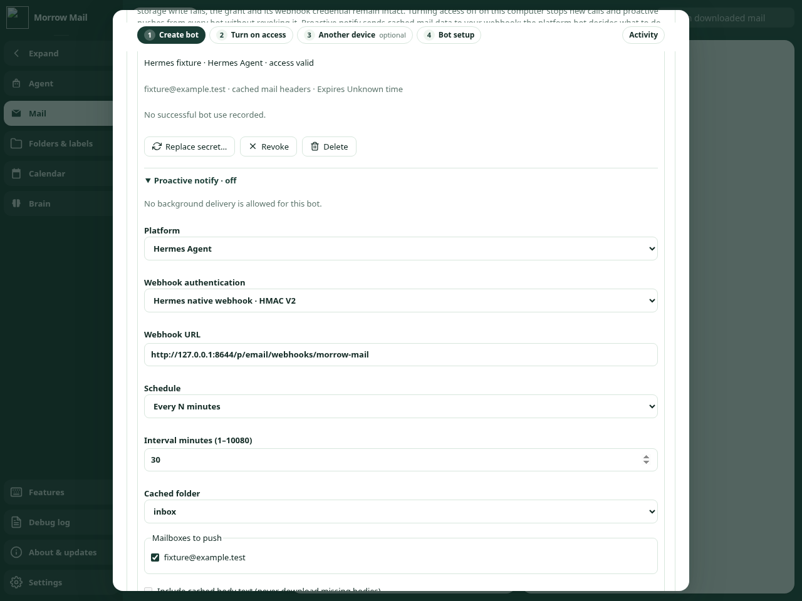
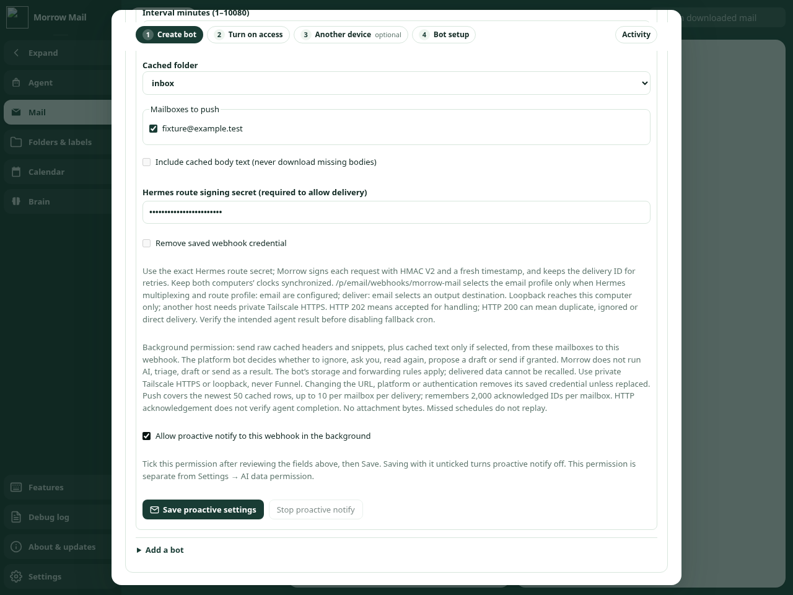
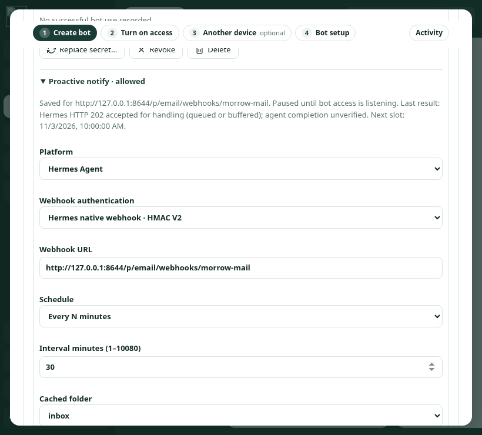

# Native Hermes webhook verification

Fixtures use synthetic mail, temporary files, memory credentials and intercepted HTTP. They do not enable a real bot or contact Hermes, an AI provider, a mailbox, Keychain or DPAPI. Chromium serves the actual first-party renderer on a temporary loopback-only fixture server with fake IPC and blocks external requests.

Run the aggregate check with Node 20 (matching CI):

```sh
npm ci
npm run check
```

`check-hermes-webhook.js` runs inside the aggregate and checks independent Python-generated HMAC-SHA256 vectors, significant whitespace/Unicode/JSON escapes, exact transmitted bytes and length, Unix seconds, refreshed retry signatures with stable body/IDs, existing Bearer settings/cursor preservation, invalid configuration, credential replacement/failed persistence/redaction, HTTP admission codes, errors/backoff, explicit consent and cancellation during secure reads. Existing proactive tests retain Bearer headers, private DNS/TLS routing, bounded responses, retry caps, lifecycle and durable-cursor coverage. Settings tests exercise the actual preload, renderer form and host validation, including mode selection and separate background permission.

Run the browser check with Chromium plus separately installed Playwright and axe (not application dependencies):

```sh
npm install --prefix /tmp/morrow-browser-deps --no-package-lock --no-audit --no-fund playwright axe-core
MORROW_PLAYWRIGHT_MODULE=/tmp/morrow-browser-deps/node_modules/playwright \
MORROW_AXE_MODULE=/tmp/morrow-browser-deps/node_modules/axe-core/axe.min.js \
node scripts/check-hermes-webhook-browser.js
```

Set `MORROW_CHROMIUM` if Chromium is not `/usr/bin/chromium`; `MORROW_UI_OUTPUT` overrides the temporary screenshot directory. The check covers native required-field focus, HMAC/Bearer mode changes, cleared permission after edits, keyboard save, fake persistence/reload, legacy Bearer settings, HTTP admission labels, Features/CLI, 1280×960 and 820×740 layouts, standard/reduced motion and WCAG 2 A/AA axe checks.

The screenshots below use the reduced-motion fixture with synthetic values. The checkbox is selected only in fake IPC; it is no evidence of real user authorization.







Live Hermes profile dispatch, the intended Bot Chat result, private cross-host Tailscale reachability, native macOS/Windows rendering and native secure-store behavior require operator verification. Keep fallback cron until the [end-to-end acceptance steps](../../BOT_BRIDGE.md#acceptance-before-replacing-fallback-cron) pass. The desktop-control daemon/SDK mismatch is outside this change.
