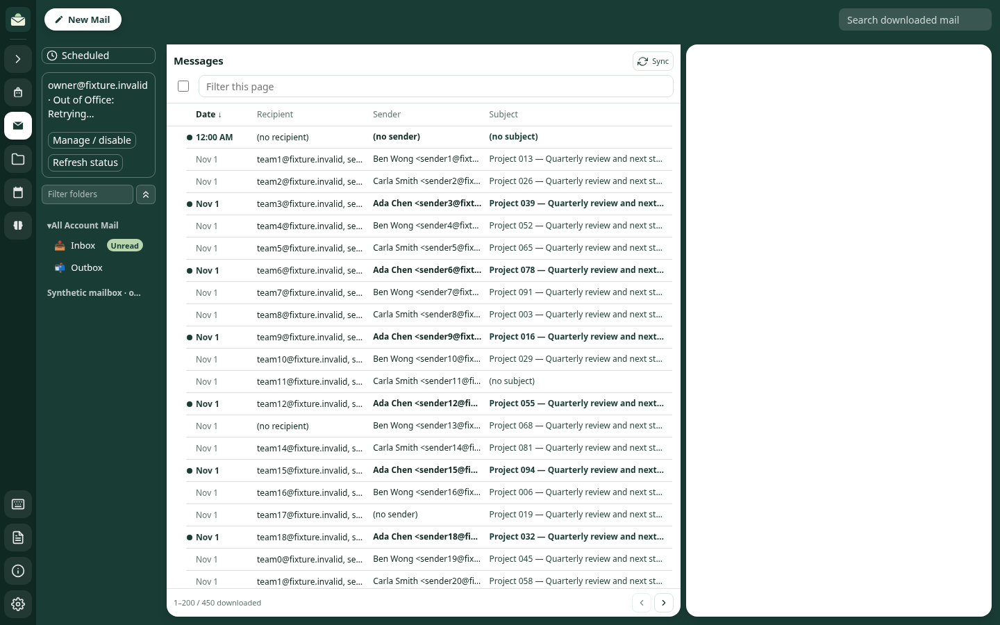
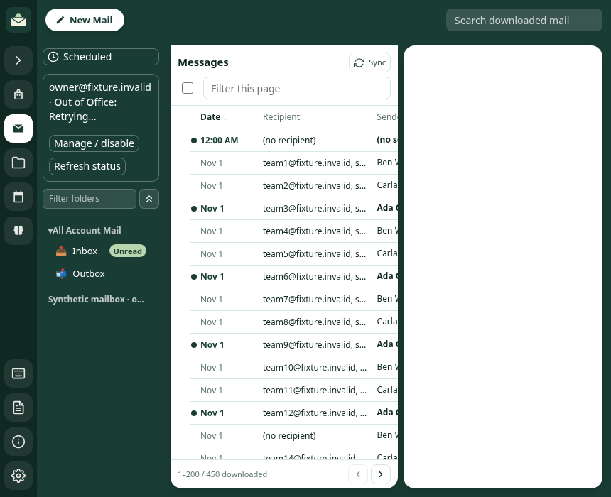
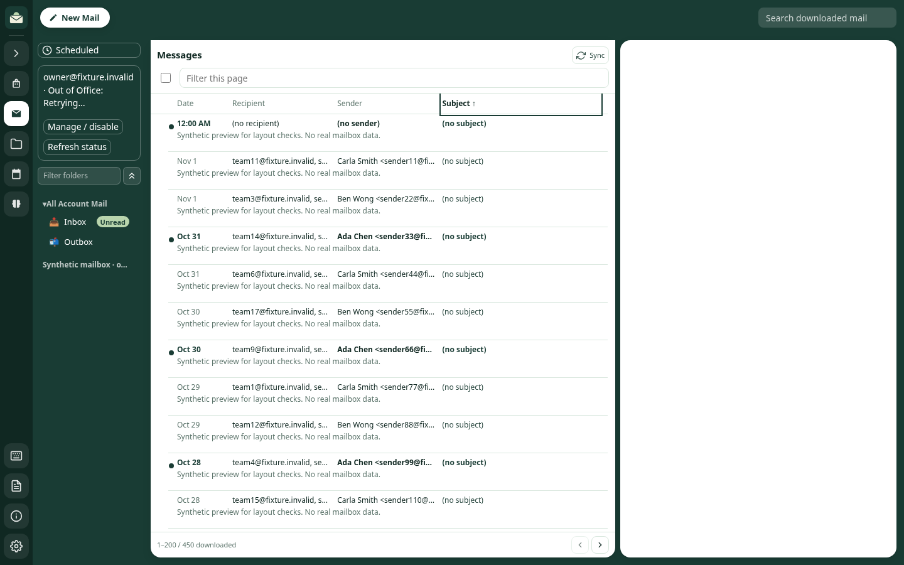

# Mail columns verification

Synthetic data only; no real account, provider, credentials or OS Keychain access.

- `npm run check`: complete offline suite passed on Linux / Node 24, including
  native SQLite and existing provider mocks. Initial environment setup needed
  the better-sqlite3 native module and Electron download before the suite ran.
- `node scripts/check-mail-columns.js`: 40 global paginated orders across Inbox,
  Sent, Drafts, two-account primary mail and unread scopes; 8 search orders before
  the 100-result cap; deterministic ties, empty fields, invalid sort input and
  stale date-cursor rejection. Each source folder has 241 rows, merged scope 482.
  Renderer tests cover direction, persistence, first-page reset, reader retention,
  missing/invalid display dates, multiple recipients, disabled Outbox headers and
  rendered Features/help consistency.
- `MORROW_PLAYWRIGHT_MODULE=/path/to/playwright node scripts/check-mail-columns-browser.js`:
  Chromium with the real HTML/CSS/renderer and synthetic cache IPC; mouse,
  Enter and Space activation, column alignment, narrow horizontal scrolling and
  both densities passed. Set `CHROMIUM_PATH` if it is not `/usr/bin/chromium`.
  This optional browser check is not a new npm dependency or part of `npm run check`.
- `node scripts/benchmark-mail-columns.js`: 10,000 synthetic messages, 12 reads
  per field, alternating directions, 200 rows at offset 1000. Observed median/max
  milliseconds: Date 1.52/19.81, Sender 20.68/21.89, Recipient 11.09/11.92,
  Subject 9.03/11.39. These are local measurements, not a native-device guarantee.
- `git diff --check`: passed.

Screenshots use a resized wide list pane and an 860px window with a narrow list.
The right reader is empty in the synthetic harness. These are Chromium checks,
not packaged macOS/Windows or assistive-technology validation. Native accessibility,
platform rendering and very large real-world cache performance remain untested.
Search keeps its existing cap and Outbox keeps scheduled ordering, as documented
in Features and the ordering ADR.

