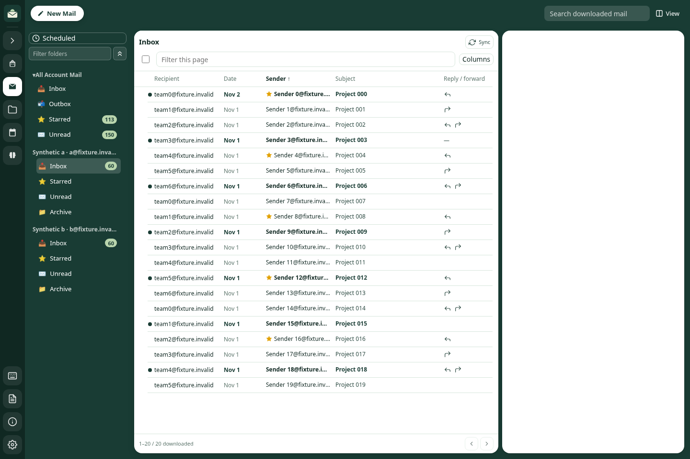
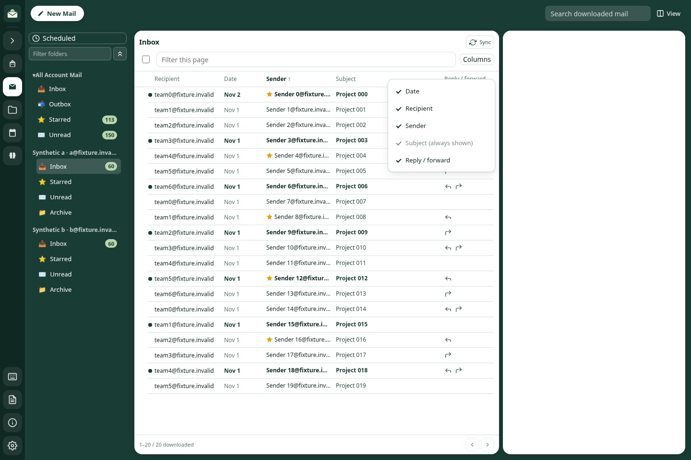
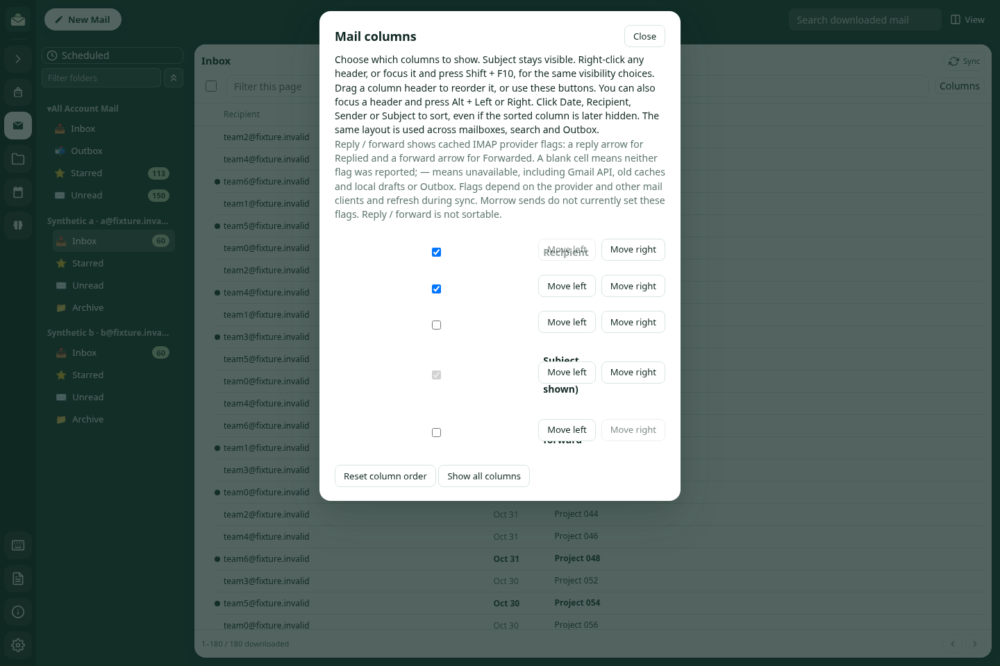
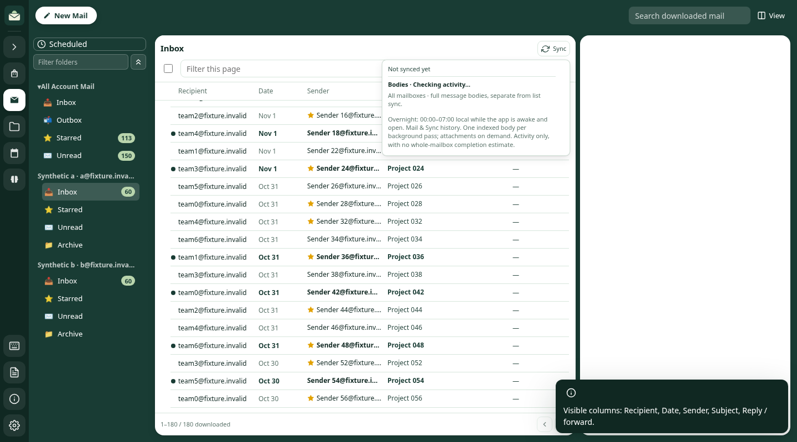
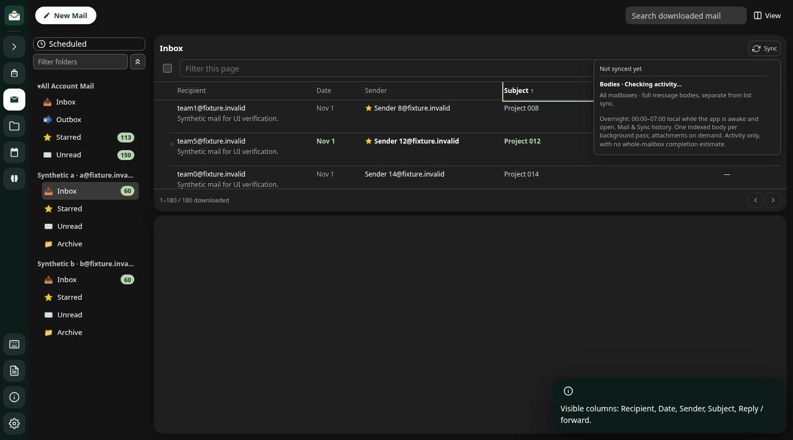
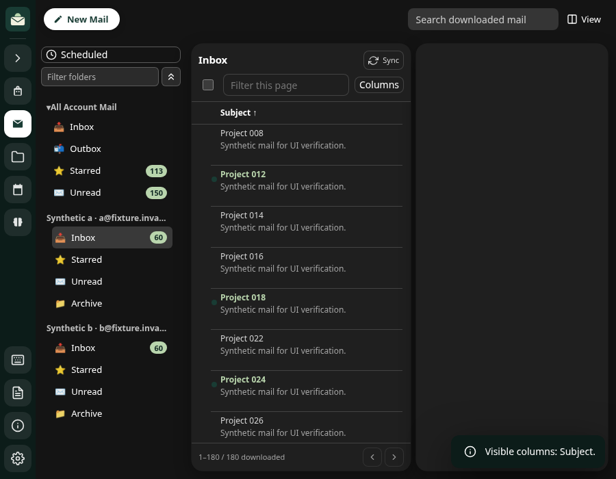
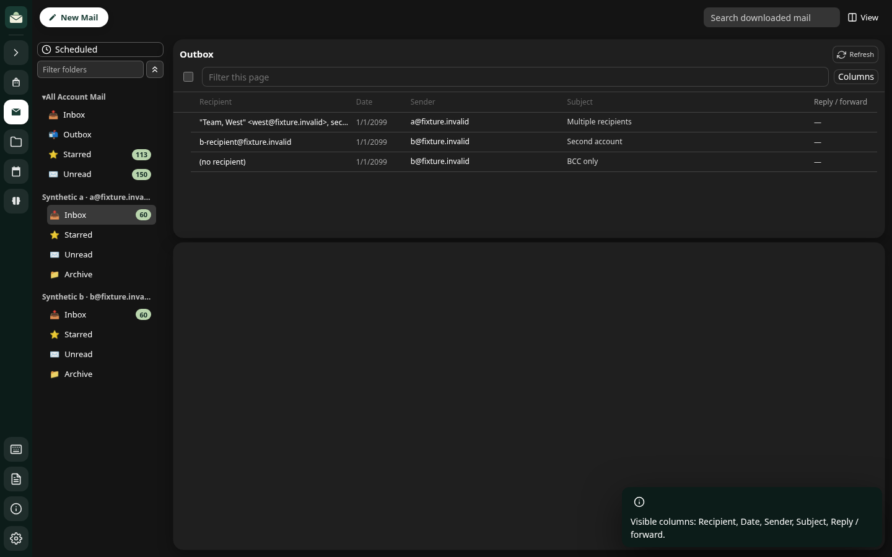

# Mail status, visibility, Sync stacking and Outbox recipients

Synthetic mail, queue records and mocked provider responses only. No live mailbox,
SMTP send, OS Keychain or actual user profile was accessed.

- `npm run check`: full offline suite, including the new provider/Outbox test and
  updated existing column, reading-layout, provider and Features consistency checks.
- `node scripts/check-mail-status-columns.js`: real IMAP parser and bounded flags
  query, true/false/unavailable combinations, case-insensitive flags, unsolicited
  UID exclusion, stale flag-page validity, account isolation, metadata-only folder
  and search results, scoped invalidation and durable restart. Gmail normalization,
  reviewed transport migration and provider refresh clear unsupported assertions.
  Body-free queue summaries flow through the real host and renderer for IMAP,
  Outlook and Gmail accounts, including quoted names, multiple recipients,
  account-scoped reads, missing/empty To and CC/BCC-only sends.
- `node scripts/check-mail-list-layout.js`: settings and actual preload allowlist,
  upgrade normalization, order/reset/drag/keyboard behaviour, shared menu/dialog
  visibility, persistent hidden choices, mandatory Subject, retained sorting,
  status labels, late-read fencing and save failure/recovery.
- `node scripts/check-mail-review-regressions.js`: real engine flag refresh reaches
  450 synthetic messages in pages of 200/200/50, carrying reply/forward flags to
  old messages. Repeating unchanged flags writes no journal/checkpoint bytes.
- `MORROW_PLAYWRIGHT_MODULE=/path/to/playwright MORROW_AXE_MODULE=/path/to/axe-core/axe.min.js MORROW_UI_OUTPUT=/tmp/morrow-status-columns-evidence node scripts/check-mail-layout-browser.js`:
  real HTML/CSS/renderer in Chromium; mouse/Enter/Space sorting, drag and keyboard
  reordering, reload persistence, context-menu/Shift+F10 navigation, Escape focus
  return, hiding the sorted column, touch checkbox controls, status refresh focus,
  and a Subject-only narrow grid. Dialog and header-menu axe checks have no
  WCAG 2 A/AA violations in their tested rules. Existing right/bottom/window,
  splitter resize, selection, search and scroll checks remain included, with
  narrow/mobile, compact/comfortable, light/dark and reduced-motion coverage.
  Sync hit tests confirm that its hover/focus panel paints above overlapping
  column headers in four layout/width/theme/density combinations. Restoring the
  old toolbar stacking reproduces the overlap; restoring the fix passes again.
- `git diff --check` and JavaScript syntax checks.

Results and environment versions are in [results.json](results.json). Browser
tooling is installed outside the checkout and adds no application dependencies.

These checks do not validate packaged macOS/Windows rendering, native screen
readers, real provider flag support or actual delivery. Gmail API indicators stay
unavailable. Morrow sends do not set these provider flags; a blank known cell is
not proof that no reply/forward happened. Normal flag rotation can delay updates
for older messages. The separate wrong-target shortcut issue in Separate window
mode is outside this change.

